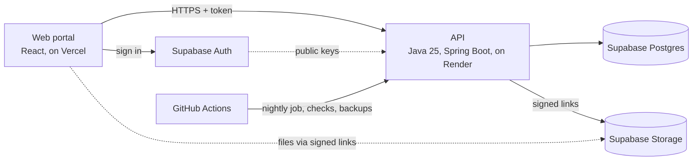

# VitalLink

A free health and fitness web app for people in the Dallas area. Each person owns their data: vitals, workouts,
nutrition, goals, medications, appointments and medical records. It leaves their account only through a share they
create and can revoke.

Group capstone, Kathmandu University, Group 2.

| | |
|---|---|
| **Website** | https://vital-link-flax.vercel.app |
| **API** | https://vitallink-9p4d.onrender.com (`/ready` for health) |
| **Design** | Figma file `JuPJkw5r1aAtdgRQk2UuaA` |

## How it fits together



Everything runs on free plans. All server code is Java. Only the API talks to the database.

## Repository

```
apps/web/        The web portal (React 19, Vite, React Router, CSS modules)      → apps/web/README.md
packages/api/    API client, sample data, form rules, screen view-models         → packages/api/README.md
packages/tokens/ Design tokens generated from Figma variables
packages/assets/ Icons generated from the Figma icon components
backend/         The API (Java 25, Spring Boot 4.1, PostgreSQL, Flyway)          → backend/README.md
scripts/         Icon generator and the screenshot tool
```

## Install and run

To try the website with sample data, you only need Node.js: do steps 1 and 2, then skip to step 5. For the full app
with the API and a database, do every step.

### 1. Install the tools

| Tool | Version | Needed for |
|---|---|---|
| Git | any current | Getting the code |
| Node.js (includes npm) | 20 or newer | The website |
| Java JDK | 25 | The API |
| Docker with Compose | current | The local database and mail catcher |
| Python (optional) | 3.12 or newer | Only the helper scripts, see below |

You don't need to install Maven or PostgreSQL: the Maven wrapper and Docker provide them. All other packages install
automatically.

**Windows** (PowerShell):

```powershell
winget install Git.Git OpenJS.NodeJS.LTS EclipseAdoptium.Temurin.25.JDK Docker.DockerDesktop
```

Restart the terminal afterwards, then start Docker Desktop. Prefer no Docker Desktop? Run `wsl --install -d Ubuntu`,
install Docker Engine inside Ubuntu using the Linux commands below, and run `docker compose up` from there (the project
is under `/mnt/c/...`). Keep that terminal open, because WSL stops the database when nothing is using it.

**macOS** (with [Homebrew](https://brew.sh)):

```bash
brew install git node
brew install --cask temurin docker
```

Then open Docker from Applications. If `java -version` doesn't show 25, install JDK 25 from https://adoptium.net.

**Linux** (Ubuntu or Debian):

```bash
sudo apt update && sudo apt install -y git curl
curl -fsSL https://get.docker.com | sudo sh
sudo usermod -aG docker $USER
```

Log out and back in so Docker works without `sudo`. Install Node.js 20+ from https://nodejs.org and JDK 25 from
https://adoptium.net, because the versions in `apt` may be too old.

Check all of them:

```bash
git --version && node -v && java -version && docker compose version
```

### 2. Get the code

```bash
git clone https://github.com/Prabin-Aman/VitalLink.git
cd VitalLink
npm install
```

Run `npm install` from the repository root only.

### 3. Create the settings files

**Windows** (PowerShell):

```powershell
copy backend\.env.example backend\.env
copy apps\web\.env.example apps\web\.env.local
```

**macOS and Linux:**

```bash
cp backend/.env.example backend/.env
cp apps/web/.env.example apps/web/.env.local
```

Open `backend/.env` and replace `change-me` with a password of your choice, in both `POSTGRES_PASSWORD` and
`DATABASE_URL`. Also set `DEV_JWT_SECRET` to a random string of 32 or more characters.

### 4. Start the database and API

Use two terminals, both in the `backend` folder. In the first, start PostgreSQL and the Mailpit mail catcher and leave
it running:

```bash
docker compose up
```

In the second, start the API. The first run downloads its dependencies, which takes a few minutes.

**Windows:**

```powershell
.\mvnw.cmd spring-boot:run
```

**macOS and Linux:**

```bash
./mvnw spring-boot:run
```

The API is ready when http://localhost:8000/ready says `ready`.

### 5. Start the website

In a third terminal, from the repository root:

```bash
npm run web
```

Open http://localhost:5173. Without `apps/web/.env.local` it shows sample data and saves nothing.

### Local addresses

| Address | What it is |
|---|---|
| http://localhost:5173 | The website |
| http://localhost:8000/docs | API explorer (Swagger UI) |
| http://localhost:8025 | Mailpit: emails sent locally, such as password resets, land here |

### Optional: a demo account full of data

With the database running, do this in the `backend` folder. It creates `demo@example.com` with 90 days of data, then
sets its password. Choose a password of 12 or more characters with a number and a symbol.

**Windows** (PowerShell):

```powershell
.\mvnw.cmd -q compile exec:java "-Dexec.mainClass=com.vitallink.api.tools.DemoSeed"
$env:VITALLINK_PASSWORD = "choose-a-password-1!"
.\mvnw.cmd -q compile exec:java "-Dexec.mainClass=com.vitallink.api.tools.SetPassword" "-Dexec.args=demo@example.com"
```

**macOS and Linux:**

```bash
./mvnw -q compile exec:java -Dexec.mainClass=com.vitallink.api.tools.DemoSeed
VITALLINK_PASSWORD='choose-a-password-1!' ./mvnw -q compile exec:java -Dexec.mainClass=com.vitallink.api.tools.SetPassword -Dexec.args=demo@example.com
```

Then sign in at http://localhost:5173/sign-in. You can also just create your own account there; its emails appear in
Mailpit.

### Optional: run the tests

With the database running:

| Tests | Windows | macOS and Linux |
|---|---|---|
| Website (repository root) | `npm test` | `npm test` |
| API (`backend` folder) | `.\mvnw.cmd test` | `./mvnw test` |

### Optional: helper scripts (Python)

The app doesn't need Python. It's only for regenerating icons (`scripts/write-icons.py`, no packages needed) and taking
screenshots (`scripts/shoot.py`), which needs:

**Windows:**

```powershell
py -m pip install -r scripts\requirements.txt
py -m playwright install chromium
```

**macOS and Linux:**

```bash
python3 -m pip install -r scripts/requirements.txt
python3 -m playwright install chromium
```

On Windows, run `$env:PYTHONUTF8 = "1"` first when running these scripts.

### Common problems

| Problem | Fix |
|---|---|
| `mvnw: Permission denied` (macOS, Linux) | `chmod +x mvnw` |
| API says it can't connect to the database | Check `docker compose up` is running, and that `DATABASE_URL` uses `127.0.0.1` and the same password as `POSTGRES_PASSWORD` |
| `Unsupported class file` or Java version errors | `java -version` must show 25 |
| Port 5432, 8000 or 5173 already in use | Stop whatever is using it, or change `POSTGRES_PORT` in `backend/.env` and `DATABASE_URL` to match |
| Docker permission denied (Linux) | Log out and back in after `usermod` |

These steps were run on Windows, with Docker inside WSL Ubuntu. The macOS, Linux and Docker Desktop commands are
standard but haven't been run on those setups, so please report anything that differs.

## Everyday commands

| Command | What it does |
|---|---|
| `npm run web` | Website on port 5173 |
| `npm run web:build` | Production build (includes the type check) |
| `npm run typecheck` | Type check, including that the screens match the API's schema |
| `npm test` | Frontend unit tests |
| `npm run api:types` | Regenerate API types from a running backend |
| `npm run tokens` | Regenerate tokens after editing `figma-variables.json` |
| `cd backend && ./mvnw verify` | All backend tests with coverage (needs Postgres) |
| `cd backend && ./mvnw spotless:apply` | Format the Java code |

## Configuration

**Vercel (website)**

| Variable | Value |
|---|---|
| `VITE_API_URL` | The API's address. Unset means sample data. |
| `VITE_SUPABASE_URL` | The Supabase project's address |
| `VITE_SUPABASE_PUBLISHABLE_KEY` | The public key. Never the secret key. |
| `VITE_SUPABASE_GOOGLE` | `1` to offer Google sign-in |

These are built into the site, so redeploy after changing them.

**Render (API):** see the configuration table in [backend/README.md](backend/README.md).

**Supabase:** a private `records` bucket, email confirmation on, the site's address under URL Configuration, and an
SMTP provider for email. Never commit secrets: `.env*` files are ignored by git, and this repository is public.

## Health data

A website can't read data from a phone, so it arrives in three ways, all under Settings › Connected Devices:

- **Apple Health export:** upload `export.zip` from the Health app. Importing again updates readings.
- **Bluetooth:** pair a strap, cuff, scale, oximeter or glucose meter in Chrome or Edge.
- **CSV file or typed readings.**

## Project rules

- **Consumers only:** no hospital, clinic or provider interface.
- **No blood features** such as blood type, donors or blood banks. Blood pressure, glucose and oxygen are fine.
- **Free plans only.**
- **Figma is the source of truth:** new UI is designed there first.
- **Text people see:** English only, no em dashes.
- **Code:** no raw colours, sizes or fonts in components; icons are generated, never redrawn; screens do no
  formatting, because view-models produce the display strings.

## Documentation

| Document | Contents |
|---|---|
| [STATUS.md](STATUS.md) | What's built, what's missing, what's untested |
| [apps/web/README.md](apps/web/README.md) | Website structure and how to add a screen |
| [packages/api/README.md](packages/api/README.md) | Client, view-models, form rules, sample data |
| [backend/README.md](backend/README.md) | Running, configuring and deploying the API |
| [backend/docs/README.md](backend/docs/README.md) | Index of the design docs and test report |
| [REQUIREMENTS.md](REQUIREMENTS.md) | Every tool and library, with versions |
