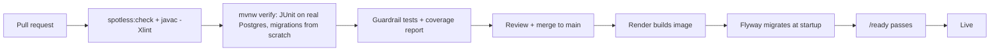

# 8. Operations and testing

## 8.1 Environments

| Environment | Runs on | Database | Auth | Purpose |
|---|---|---|---|---|
| Local | `docker compose up` (Postgres 16) + `./mvnw spring-boot:run`; files in `.storage/` behind signed URLs | Container, seeded demo user (`DemoSeed`) | Dev tokens (`ENV=local` only) | Day-to-day work |
| CI | GitHub Actions runner | Postgres service container | Dev tokens | Every pull request |
| Production | Render free web service, Virginia | Supabase free, us-east-1, session pooler :5432 | Supabase Auth, email confirmation on | Demo and real use |

One Docker image serves every environment. Only environment variables differ.

## 8.2 Configuration (`backend/.env.example` documents every key)

| Setting | Where |
|---|---|
| `DATABASE_URL`, `SUPABASE_URL`, `SUPABASE_SERVICE_ROLE_KEY`, `STORAGE_BUCKET` | Render secrets |
| `JOB_SECRET` | Render + GitHub Actions secrets (same value); the workflow also needs `API_URL` |
| `BACKUP_PASSPHRASE` | GitHub Actions secret only (backup workflow) |
| `CORS_ORIGIN`, `ENV`, `DATABASE_POOL_SIZE` | Plain env vars with safe defaults |

## 8.3 Delivery pipeline

Any failure stops the pipeline. Render keeps the previous version serving until the new one is
healthy, and rolling back is one click. Migrations follow expand → migrate → contract, so the old
version keeps working while the new one deploys.

Contract drift is caught on both sides. Backend CI regenerates `packages/api/src/openapi.gen.ts` from the
packaged jar and fails if the committed copy differs (run `npm run api:types` against a local API and
commit it). `frontend.yml` runs `npm run typecheck`, which includes `contract.ts`: every field
`types.ts` declares must exist in the generated schema.

## 8.4 Scheduled workflows (GitHub Actions)

| Workflow | Schedule | Does |
|---|---|---|
| `frontend.yml` (built) | push / PR touching `apps/`, `packages/` | `npm ci`, typecheck (web and mobile, each with its own TypeScript, plus the API contract), web build |
| `nightly.yml` (built) | 09:00 UTC (≈ 03:00–04:00 Central) | Wake `/ready` (retries for the cold start), then `POST /internal/jobs/nightly`; any failed user or step makes it answer 500, so the run fails (8.8) |
| `backup.yml` (built) | weekly | `pg_dump` → `gpg` AES-256 (`BACKUP_PASSPHRASE`) → workflow artifact kept 90 days. **Repo must be private** |
| `deploy-check.yml` (built) | on merge + daily | The lockdown checks in 6.2 against the live project |

**Restore drill** (`backend/scripts/restore-drill.sh`, run 27 Oct 2026 on the local demo database): the
same dump and encryption as `backup.yml`, then decrypt, `pg_restore` into `<db>_restore`, and compare
every table. Result: 34 tables, 190,080 rows identical (Flyway's history included), row-level security on
every table. What it taught: restore into a server of the **same major version as the dump tools** — a
PG 17 dump fails on PG 16 (`transaction_timeout`), so the script picks the server's version and the
workflow's restore note says 17 (Supabase's version). Repeat it against the real backup once Supabase exists.

Keepalive is **not** a GitHub workflow. Each run bills at least one minute, and pinging every 10 minutes
would use about 3,000 of a private repo's 2,000 free minutes a month. A free external monitor
(UptimeRobot or similar) calls `GET /ready` every 10 minutes from 12:00 to 05:00 UTC instead. That
keeps Render awake in Dallas daytime and keeps the Supabase project active.

## 8.5 Observability

- **Logs.** One JSON line per request: request id, route template, status, duration, user id. Never
  bodies. Render keeps and searches them.
- **Request ids** go in a response header and every error body, so a screenshot of an error leads to
  its log line.
- **Watch:** error rate, requests > 1 s, DB size against 500 MB, refused-access counts per user (a
  spike means probing), and nightly job failures.

## 8.6 Free-tier limits and how we stay inside them

| Limit | Our load | Verdict |
|---|---|---|
| Render 512 MB RAM, sleeps after 15 min | JVM capped at 70% of RAM, serial GC; ~200–250 MB in use | Fits; keepalive ping. Cold start ~15 s |
| Render 750 instance-hours/month | Awake ~17 h/day ≈ 520 h | Fits; the keepalive window leaves the night to sleep |
| Supabase 500 MB DB | ~13.5 MB per user-year | ~30 user-years |
| Supabase 1 GB storage, 5 GB egress | Lab PDFs 0.2–2 MB; dashboard ~5 KB | Fine |
| Supabase pauses after 7 days inactive | Keepalive hits the DB through `/ready` | Fine |
| GitHub Actions minutes (private repo: 2,000/month) | Nightly ~2 min + backup ~3 min + CI ~5 min per PR | Fine. Keepalive runs outside Actions (8.4) |

## 8.7 Testing strategy

Tests run against **real Postgres**, because the guarantees that matter (upsert de-dup, cascades,
the append-only trigger, check constraints) live in the database.

| Level | Covers | Examples |
|---|---|---|
| Unit (pure) | `decide()`, readiness score, streaks, goal status, insight statistics, interpretation, dose state, BMR | Expiry is exclusive; vitals grant never opens records; unconfirmed email matches nothing; random noise yields no insight; DST day has 23 h of buckets |
| Integration | Each service + repository against Postgres | Re-sent bucket overwrites; same key + new payload → 409; parallel first requests both succeed; edited food leaves old meals unchanged; one active plan per user |
| API | Full HTTP through the app (MockMvc: filters, transactions, error handler) | Grant → read → revoke → refused; refusal appears in the owner's access log; pending upload never downloadable; another user's id on `/me/...` → 404 |
| Contract | Responses vs `packages/api` | Each endpoint's JSON validated against the TypeScript shape (via the generated JSON Schema) |
| Guardrails | The codebase itself | 6.6 list |
| Deployment | The live Supabase project | No exposed tables; RLS on; no anon grants; bucket private |
| Migrations | Schema history | CI migrates an empty database every run; catalogue tables match the code; every table has RLS; nothing in `public` |
| Manual | What automation can't judge | iPhone + Watch steps don't double; late watch data corrects a bucket; Android Health Connect; cold start; the demo script |

**Seed data.** `tools.DemoSeed` creates a demo account with 90 days of realistic data in every module. The Figma
sample values are the anchor, so a live demo looks like the designs. The data has a planted
screen-time → lower deep-sleep pattern, so the insight engine finds something real.

## 8.8 Failure modes: ingest, nightly job, record files

From the phase 10 review (docs/13). "Detect" means what someone sees without opening the code.

| Failure | Detect | Recover |
|---|---|---|
| **Ingest.** Render is cold (~15 s) and the phone times out, then retries | Duplicate `idempotency_key` replays in logs (`replayed: true`) | Nothing to do. Same key + same payload replays the stored counts. The advisory lock stops a retry that races the original from applying twice |
| A retry carries the same key but a changed payload (an app bug) | 409 `idempotency_conflict` | The app must send a new key for new data. Nothing was written |
| One bad bucket (unknown metric, off the 5-minute grid, out of range, in the future) | 422 `invalid_buckets` with up to 20 indices. A user stuck re-sending the same batch shows up as repeated 422s from one user | The whole batch is refused, so nothing is half-saved. The app must drop or fix the listed buckets and send the rest under a **new** key, or sync stalls for good |
| Phone over its quota (60 batches/hour) | 429 `rate_limited` + `Retry-After` | The app waits `Retry-After`. Nothing is lost: buckets are re-sent and upserted |
| Database full (500 MB) or down | `/ready` 503; ingest 500s; Supabase usage page | The phone keeps its queue. Free space (raise the retention of `ingest_batches`, export and delete old readings) or wait for Supabase. Re-sync is idempotent |
| **Nightly job.** The workflow can't wake Render or the call times out (600 s) | The `nightly` workflow run fails (GitHub emails the owner) | Re-run the workflow (`workflow_dispatch`). Every step is a condition and every notification has a dedupe key, so a second run adds nothing twice |
| One user's step throws (bad data, a bug) | **HTTP 500** with `users_failed` > 0 in the summary, so the workflow goes red; the log line names the user id | The other users and all cleanups still ran. Fix the data or the bug, then re-run |
| A cleanup step throws (e.g. Storage down while draining file deletions) | HTTP 500 with the step in `steps_failed` | The other steps still ran. Queued file deletions stay queued and are retried next night |
| Two runs at once (manual + cron) | 409 `job_running` | None needed: one instance, one lock |
| `JOB_SECRET` missing, or shorter than 32 characters in production | 503 `jobs_not_configured` | Set a long secret (`openssl rand -hex 32`) on Render and in the repo secrets |
| **Record files.** The client never uploads after `/upload` | Record stays `pending` | The nightly job resets it to `none` after a day and deletes any half-written object |
| The stored file isn't a PDF/image ≤ 25 MB | 422 `file_rejected` on `/confirm` | The object is deleted at once. The record keeps waiting for a new upload |
| A **replacement** upload is abandoned or rejected | The record stays `attached` with the old file | The old file is kept until the new one is confirmed. The nightly job drops a replacement older than a day |
| `/confirm` runs while the nightly cleanup resets the same record | One of them wins cleanly. The cleanup locks and re-checks the row, and confirm only updates the key it checked (409 `no_pending_upload` if it lost) | Upload again |
| Storage is down at upload, confirm or download | 503 `storage_unavailable` (logged with the request id) | Nothing was changed (the request's transaction rolls back). Try again |
| Storage is down when a record or account is deleted | `couldn't delete stored file` in the log | The key was queued in `file_deletions` in the same transaction. The nightly job deletes it later, and the step fails (red workflow) until Storage answers |

**Gate.** Nothing merges unless formatting, compilation, tests and guardrails pass. Every consent
rule has at least one test. Results and coverage: [12-test-report.md](12-test-report.md).
